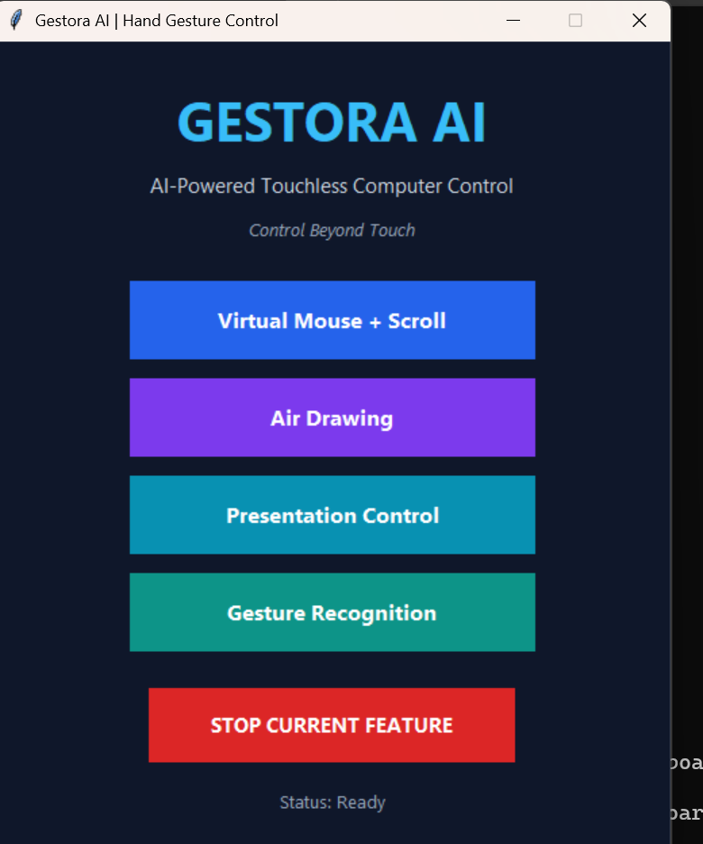
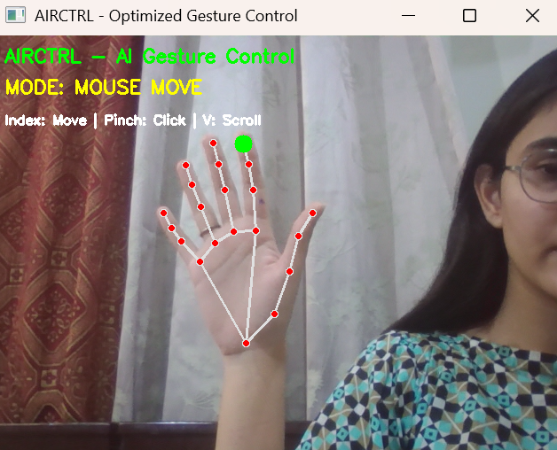
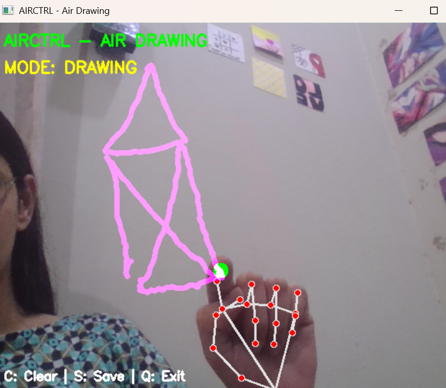
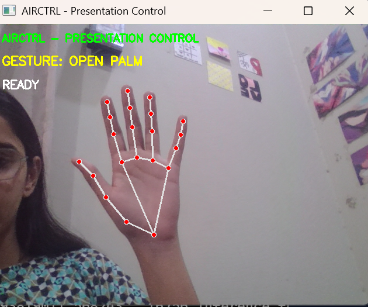
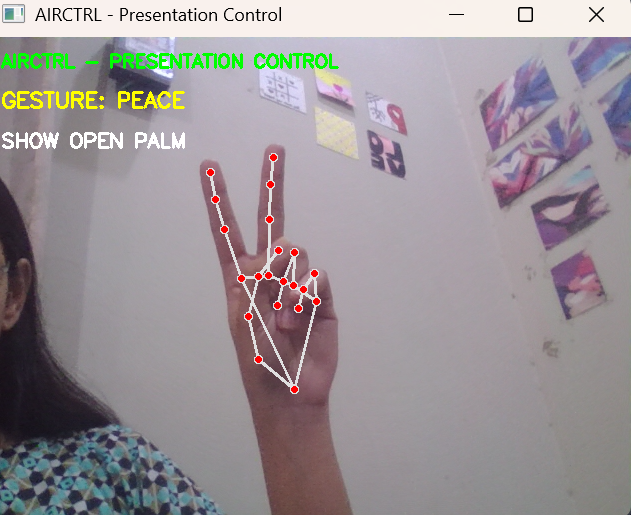
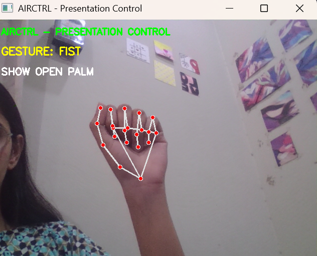

# Gestora AI — Hand Gesture Control System

### Control Beyond Touch

Gestora AI is a Python-based computer vision application that allows users to interact with their computers using hand gestures captured through a webcam.

The system combines MediaPipe for real-time hand tracking, OpenCV for video processing, and PyAutoGUI for mouse and keyboard automation.

It features a desktop dashboard developed using Tkinter, allowing users to launch and manage different touchless interaction features from one interface.

## Application Preview

### Gestora AI Dashboard



### Virtual Mouse Control

Control the mouse cursor using hand movements.



### Air Drawing

Draw virtually in the air using your index finger.



### Presentation Control

**Open Palm — Reset / Ready**



**Peace — Next Slide**



**Fist — Previous Slide**



## Demo Video

Watch Gestora AI in action:

[View Gestora AI Demo Video](demo/recording.mp4)

The demonstration video shows the system's gesture-based interaction capabilities.

---

## Features

### 1. Virtual Mouse and Scrolling

- Move the mouse cursor using your index finger.
- Perform left clicks using a thumb-index pinch.
- Scroll webpages using two raised fingers.
- Interact with your computer without a physical mouse.

### 2. Air Drawing

- Draw virtually using your index finger.
- Pause drawing using two fingers.
- Press `C` to clear the canvas.
- Press `S` to save drawings as PNG images.
- Press `Q` to exit the drawing window.

### 3. Hand Gesture Recognition

The system recognizes five predefined gestures:

- Open Palm
- Fist
- Peace
- Thumbs Up
- Pointing

Gesture classification is based on hand landmark positions and predefined finger-state rules.

### 4. Presentation Control

Control presentation slides using hand gestures.

| Gesture | Action |
|---------|--------|
| Peace | Next slide |
| Fist | Previous slide |
| Open Palm | Reset / Ready for next gesture |

The presentation controller includes gesture stability checks and a cooldown mechanism to reduce accidental slide changes.

### 5. Desktop Dashboard

The Tkinter-based dashboard provides:

- Virtual Mouse + Scroll
- Air Drawing
- Presentation Control
- Gesture Recognition
- Stop Current Feature
- Feature status display

Only one feature can be launched at a time through the dashboard.

---

## Technologies Used

| Technology | Purpose |
|------------|---------|
| Python 3.11 | Main programming language |
| OpenCV | Webcam capture and image processing |
| MediaPipe | Hand landmark detection |
| PyAutoGUI | Mouse and keyboard automation |
| NumPy | Numerical operations |
| Tkinter | Desktop graphical interface |
| Git & GitHub | Version control and project hosting |

## How Gestora AI Works

1. The webcam captures live video frames.
2. OpenCV processes the frames.
3. MediaPipe detects 21 hand landmarks.
4. Python analyzes fingertip positions and finger states.
5. Rule-based gesture recognition determines the requested action.
6. PyAutoGUI executes the corresponding mouse or keyboard command.

**Technical Note:** Gestora AI uses MediaPipe's pretrained hand landmark detection model. Its gesture recognition logic is currently rule-based rather than a separately trained custom machine learning classifier.

---

## Installation

### Prerequisites

- Python 3.11
- Windows 10 or 11
- Working webcam
- Internet connection for installing dependencies
- Git (optional)

### Step 1: Clone the Repository

```bash
git clone https://github.com/FaseehaAzam/Gestora-AI.git
cd Gestora-AI
```

Alternatively, download the repository as a ZIP file and extract it.

### Step 2: Create a Virtual Environment

Open Command Prompt inside the project folder.

```cmd
py -3.11 -m venv gestora_env
```

Activate the environment:

```cmd
gestora_env\Scripts\activate
```

### Step 3: Install Dependencies

```cmd
python -m pip install -r requirements.txt
```

## Run the Application

Launch the main dashboard:

```cmd
python dashboard.py
```

The Gestora AI dashboard will open.

Select a feature to begin using hand gestures.

To stop a running feature, click **STOP CURRENT FEATURE**.

---

## Run Individual Features

Individual modules can also be launched separately.

### Webcam Test

```cmd
python camera_test.py
```

### Hand Tracking

```cmd
python hand_tracking.py
```

### Virtual Mouse

```cmd
python virtual_mouse.py
```

### Virtual Mouse and Scrolling

```cmd
python airctrl_scroll.py
```

### Air Drawing

```cmd
python air_drawing.py
```

### Gesture Recognition

```cmd
python gesture_recognition.py
```

### Presentation Control

```cmd
python gesture_shortcuts.py
```

---

## Project Structure

```text
Gestora-AI/
|
|-- dashboard.py
|-- camera_test.py
|-- hand_tracking.py
|-- virtual_mouse.py
|-- airctrl_scroll.py
|-- air_drawing.py
|-- gesture_recognition.py
|-- gesture_shortcuts.py
|-- requirements.txt
|-- README.md
|-- .gitignore
|
|-- screenshots/
|   |-- dashboard.png
|   |-- virtual_mouse.png
|   |-- air_drawing.png
|   |-- presentation_open_palm.png
|   |-- presentation_peace.png
|   |-- presentation_fist.png
|
|-- demo/
|   |-- recording.mp4
```

## Application Controls

| Feature | Gesture / Key | Action |
|---------|---------------|--------|
| Virtual Mouse | Index finger | Move cursor |
| Virtual Mouse | Thumb-index pinch | Left click |
| Scrolling | Two raised fingers | Scroll |
| Air Drawing | Index finger | Draw |
| Air Drawing | Index + middle fingers | Pause drawing |
| Air Drawing | C | Clear canvas |
| Air Drawing | S | Save drawing |
| Air Drawing | Q | Quit |
| Presentation | Peace | Next slide |
| Presentation | Fist | Previous slide |
| Presentation | Open Palm | Reset / Ready |

---

## System Requirements

- Working webcam
- Python 3.11
- Windows 10 or 11
- Required Python dependencies
- Adequate lighting for hand tracking
- Sufficient processing power for real-time video processing

Performance may vary depending on webcam quality, lighting conditions, and computer hardware.

## Current Limitations

- Gesture recognition depends on hand visibility and lighting.
- Rapid movements may reduce tracking stability.
- Similar gestures may occasionally be confused.
- Lower-powered devices may experience performance issues.
- Gesture classification currently relies on predefined rules.

## Future Improvements

- Develop a custom-trained gesture classification model.
- Improve recognition accuracy and stability.
- Add customizable keyboard shortcuts.
- Introduce adjustable gesture sensitivity.
- Optimize real-time processing performance.
- Add more accessibility-focused features.
- Enhance the desktop dashboard interface.

## Learning Outcomes

Through this project, I gained practical experience in:

- Computer vision
- Real-time hand tracking
- Human-computer interaction
- Gesture recognition
- Python GUI development
- Mouse and keyboard automation
- Integration of multiple Python modules
- Git and GitHub version control

---

## Author

**FaseehaAzam**

AI Student | Python | Computer Vision | Machine Learning

GitHub: https://github.com/FaseehaAzam

## Repository

https://github.com/FaseehaAzam/Gestora-AI

## License

No license has been selected for this project.

